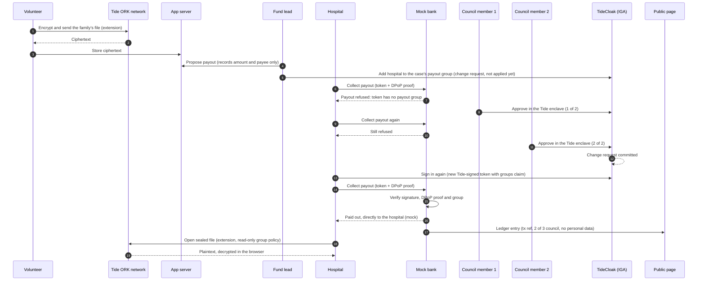

## Project overview

**WholeLeaf is a charity fund that pays a hospital only after 2 of 3 council members approve, so no hero, admin or AI can decide alone.**

### Vision & originality
Small charities depend on donors trusting one person. WholeLeaf replaces that person with a rule: a case's payout group starts empty, and the bank pays only once the hospital is in it. A charity product, not a login demo.

### Trust constraint insight
Charity offers transparency, privacy or control: pick two. In September 2024, 12,000+ pages of Typhoon Yagi bank statements were published, exposing donors' names and messages. Decree 93/2021/ND-CP only requires results after collection or distribution ends. Families post ID cards and medical records on Facebook to be believed. Remove the need to trust a hero: donors verify, families stay private.

### Value & impact
Ms. Lan in Quang Binh needs 50,000,000 VND for her child's surgery. Donors see the payout on a public ledger with no personal data; her files stay private. Money goes only to Hoa Binh Hospital (mock).

### Why TideCloak matters
- **Approval:** adding the hospital to group `/payout-case-<id>` is an IGA change request needing 2 of 3 council approvals in the Tide enclave.
- **Signature:** tokens are signed by the Tide network's threshold key, so no admin or server can mint the payout permission.
- **Enforcement:** the mock bank verifies signature and DPoP, paying only if the token carries `/payout-case-<id>`.

### Prototype & storytelling
Open `/demo` and play through one synthetic case: ask the hospital to collect before approval, add two council seals, collect again, then see the donor receipt appear. This interactive simulation needs no sign-in or Tide network. The live role pages continue to use TideCloak for signed requests and approvals. "Try to forge payout authority" shows "Forged token rejected" in the live fund-owner view.

Limits: a colluding 2-of-3 quorum can approve; a real bank must verify Tide tokens; council members are realm admins; payments are mocked.

## About WholeLeaf

**WholeLeaf: Charity without trusting a hero.** Named after a Vietnamese proverb: the whole leaf shelters the torn one.

The prototype is a charity product with a council, a mock hospital and a mock bank. TideCloak is the part that stops any one person, admin or AI from overriding the rules. The TideCloak realm and the npm package are named `clearaid` (client `clearaid-client`). That is a technical name from an earlier working title; the product is WholeLeaf.

## How it works

WholeLeaf has a **core** that needs only TideCloak IGA and Tide-signed tokens, and an **extension** that seals the family's file with Tide's encryption.

**Core: a payout is a group membership.**
- Each case has a payout group `/payout-case-<id>`, which starts **empty**. Membership of that group is the authority to collect the money for that case. The app does not create the group: it is created empty in the TideCloak admin console (see [docs/DEMO_SETUP.md](docs/DEMO_SETUP.md)).
- The fund lead clicks "Propose payout" on `/council`. That only records the amount and the payee in the app. Nothing is paid and nothing is unlocked.
- The fund lead then adds the hospital's account to the group in the TideCloak admin console (Groups, `payout-case-<id>`, Members, Add member). That creates an IGA change request. It needs `floor(admins * 0.7)` approvals, which is 2 of the 3 council members (realm admins). Each approval is made in the Tide enclave, in the TideCloak admin console under Change requests.
- Tide access tokens are signed by the Tide network's threshold key (VVK). No single server or admin holds that key, so nobody can mint a token with that permission.
- The mock bank (`/api/bank/payout`) verifies the token signature and the DPoP proof, and pays only if the verified token carries the case's payout group. The money goes directly to the hospital, never to an individual. Before that, the hospital's "Collect payout" shows the refusal panel "Payout refused"; after, "Paid out".
- A forged token (edited payload, old signature) is rejected by `/api/bank/verify-token`. On `/operator`, "Try to forge payout authority" takes the signed-in user's real token, adds the payout group to the payload, keeps the old signature and asks the verifier. The result reads "Forged token rejected".
- The council page also has a "Log my approval publicly" button. It only writes a public log entry (a seal on the public page). The binding approval happens in TideCloak under Change requests.

**Extension: the family's file is sealed** (needs the built-in contract `RelationshipAttestation:1`; see [Before you start](#before-you-start)).
- A council member first sets up the case on `/council` ("Set up case", inside the collapsed "Optional: sealed-file access rules"). Two policies are signed in the Tide enclave: one lets the volunteer encrypt and re-read the case, the other is a read-only policy for the payout group.
- The volunteer encrypts the applicant's file (ID, medical summary) in the browser through Tide's threshold network (the ORKs) with "Encrypt and send". The server and the fund owner store and see only ciphertext.
- Because the payout group has a read-only policy, the hospital can decrypt the file ("Open sealed file", inside the collapsed "Optional: open the sealed file") once it is approved into the group. Before that, the ORKs refuse.
- If the network does not have the contract, this part is roadmap and the core still works.

**Public page.** `/public` ("Public ledger" in the top bar) shows donations ("Donate (mock)"), per-case progress, and a payout ledger with a transaction reference and "2 of 3 council". It never shows personal data.

### Who can see what, and who can pay?

| Who | Can read the family's file? | Can authorise or collect a payout? |
|---|---|---|
| Donor / public (`/public`) | No. Never any personal data. | No. Sees donations, per-case progress and the payout ledger. |
| Volunteer (`/volunteer`) | Seals (encrypts) the file, and can read it back for the cases they opened (a read-write policy for that volunteer and case). Not other volunteers' cases. | No. |
| Fund owner (`/operator`) | No. The page shows aggregate progress; the Tide network refuses to decrypt for an account with no matching policy. | No. Cannot mint a token; a forged token is rejected. |
| One council member on their own (including the fund lead) | No. | No. One approval is below the quorum of 2. |
| Two of the three council members | No. Approving a group change does not give the approvers decryption. | Together, yes: they approve adding the hospital to the case's payout group. |
| Hospital, before approval | No. The ORKs refuse: the group is empty. | No. The bank refuses: the token has no payout group. |
| Hospital, after 2 of 3 approvals | Yes, **read-only** (extension). | Yes, for that one case. The money goes directly to the hospital. |
| Mock bank (`/api/bank/payout`) | n/a | Pays only if a verified token carries the case's payout group. |

## Honest limits

- **Quorum collusion.** A colluding 2-of-3 quorum can approve a payout. More independent council members raise the bar (the quorum stays at 70% of admins). Every approval is signed and recorded.
- **The bank is a mock.** A real bank would need to verify Tide tokens (signature and DPoP proof). That is an integration assumption, not something this prototype proves.
- **Council members are realm admins.** In this prototype the three council members are admins of one TideCloak realm.
- **Signing a tamper-proof statement is roadmap.** It needs a custom Forseti contract, which the Tide team deploys.
- **The encrypted file needs the contract.** `RelationshipAttestation:1` is on Tide's ORK main since 2026-10-16. If the network used by the container lacks it, the extension does not run.
- **Whoever controls a case group controls access.** Membership of `/payout-case-<id>` is the authority for that case.
- **Removal is not instant.** Removing a user from a group or role takes effect when their token refreshes, up to 120 s.
- **Payments and data are mocked.** No money moves. All families, names and numbers are made up. The app uses a JSON file as its database.

## Before you start

The built-in contract `RelationshipAttestation:1` (used by the extension) is new, on Tide's ORK main since 2026-10-16, and not on every Tide network. Confirm with the Tide team on Discord (#support, https://discord.gg/XBMd9ny2q5) that the network used by `tideorg/tidecloak-dev` has it. If policy signing fails with an unknown contract, that is the cause. The core (group, token, mock bank) does not depend on it.

## Setup

Run the whole demo on **one laptop**: TideCloak and the app both run on localhost, and each role gets its own Chrome profile (or one incognito window; incognito windows share one session with each other). The same steps work on macOS and Windows.

**Prerequisites**

- **macOS:** Docker Desktop (Apple Silicon is fine), Node.js 20+, and `brew install jq`.
- **Windows 10/11:** Docker Desktop (WSL 2 backend), Node.js 20+, Git for Windows (it provides Git Bash, which the init script uses automatically), and `winget install jqlang.jq`. Then open a new terminal.

**Steps**

1. `npm install`
2. Copy `.env.example` to `.env`:
   - macOS: `cp .env.example .env`
   - Windows (PowerShell): `Copy-Item .env.example .env`

   Then edit `.env` and set the three values:
   - `KC_BOOTSTRAP_ADMIN_PASSWORD` (the TideCloak master-admin password; pick your own)
   - `TIDE_LICENSE_EMAIL` (the email address that manages your Tide licence)
   - `TIDE_TERMS_ACCEPTED=yes` only after you have read and agree to https://tide.org/legal

   Do not edit `.env` in Windows Notepad: it can save CRLF line endings and break the init script. Use VS Code or another editor that keeps LF. The repo has a `.gitattributes` that forces LF for `.env*`, `*.sh`, `*.json` and `*.template`.
3. `npm run doctor` checks Node, Docker, jq, Git Bash (Windows), ports 8080 and 3000, and `.env`. Fix anything it reports before continuing.
4. `npm run init` starts TideCloak in Docker, creates the realm, enables IGA and prints an invite link.
5. Open the printed invite link and create or link the first admin's Tide account. The script continues by itself once the account is linked.
6. `npm run dev`
7. Open http://localhost:3000

Then follow [docs/DEMO_SETUP.md](docs/DEMO_SETUP.md) to create the other four accounts, their roles, the first case and its empty payout group.

Pages: `/` (home), `/demo` (interactive simulated case), `/volunteer`, `/council`, `/hospital`, `/operator`, `/public`. The top bar links read, in order: Home, Try the story, Volunteer, Council, Hospital, Fund owner, Public ledger. Mock bank API: `/api/bank/payout` and `/api/bank/verify-token`. TideCloak runs at http://localhost:8080, the app at http://localhost:3000.

If something fails, see the Troubleshooting table in [docs/DEMO_SETUP.md](docs/DEMO_SETUP.md#troubleshooting). Fallback on Windows if `npm run init` cannot find Git Bash: open Git Bash and run `bash scripts/init-tidecloak.sh`.

## Demo walkthrough

Accounts: `council1`, `council2`, `council3` (realm admins), `volunteer` and `hospital`. The init script creates the first admin with the username `admin`; in these docs that account is called `council1` and acts as the fund lead. The three council seats are "Fund lead" (`council1`), "Local Red Cross" (`council2`) and "Donor representative" (`council3`). Use a separate Chrome profile (or one incognito window) per person. Setup is in [docs/DEMO_SETUP.md](docs/DEMO_SETUP.md). The case is Ms. Lan's, in Quang Binh (case id `lan-quang-binh`); the hospital is "Hoa Binh Hospital (mock)". All data is synthetic.

Before the take (done once, see [docs/DEMO_SETUP.md](docs/DEMO_SETUP.md)): the volunteer clicks "Create case" on `/volunteer`, the empty group `payout-case-lan-quang-binh` exists in TideCloak, and `council1` clicks "Set up case" on `/council` (inside the collapsed "Optional: sealed-file access rules").

1. **Volunteer seals the file.** Sign in as `volunteer`, open `/volunteer`, and add Ms. Lan's ID and medical summary (made up) to her case with "Encrypt and send". The browser encrypts them (extension).
2. **Fund owner.** Sign in as `council3` (a council account with no approvals in the demo) and open `/operator`. The fund owner sees aggregate progress; trying to open a file with their own access is refused (extension).
3. **Fund lead proposes.** Sign in as `council1`, open `/council`, choose the case, and click "Propose payout" for 50,000,000 VND to "Hoa Binh Hospital (mock)" (Hospital username `hospital`). This only records the proposal. The status becomes "Payout proposed".
4. **Fund lead adds the hospital to the group.** In the TideCloak admin console (http://localhost:8080/admin/clearaid/console/), `council1` opens Groups, `payout-case-lan-quang-binh`, Members, Add member, and adds `hospital`. This creates a change request. It is not applied yet.
5. **Hospital is refused.** Sign in as `hospital`, open `/hospital`, and click "Collect payout". The refusal panel "Payout refused" appears: the token has no payout group. "Open sealed file" (inside the collapsed "Optional: open the sealed file") is refused by the ORKs too (extension).
6. **Council member 1 approves.** `council1` opens Change requests in the console and approves in the Tide enclave popup (1 of 2). The hospital tries again: still refused.
7. **Council member 2 approves.** `council2` approves the same request in the console (2 of 2). The quorum is reached and the request commits.
8. **Hospital collects.** The hospital signs out and in again (or waits up to 120 s for the token refresh) and clicks "Collect payout". The bank verifies the token and pays the hospital directly (mock). The status becomes "Paid out". The hospital can now click "Open sealed file" and read the file, read-only (extension).
9. **Public ledger.** Open `/public`. A donor can click "Donate (mock)" to see progress move. The ledger shows the payout with a transaction reference and "2 of 3 council", and no personal data.
10. **Forged token.** On `/operator` (still signed in as `council3`), click "Try to forge payout authority". The result reads "Forged token rejected".

Optional: after approving in TideCloak, a council member can click "Log my approval publicly" on `/council`. It only writes a public log entry (a seal on `/public`). It is not the approval: the binding approval is in TideCloak under Change requests.

## Built with

- TideCloak (Tide identity and threshold cryptography, Tide-signed access tokens with DPoP, IGA change requests)
- Tide MCP Agent Pack (scenario `relationship-attestation`, contract `RelationshipAttestation:1`, for the extension)
- Next.js
